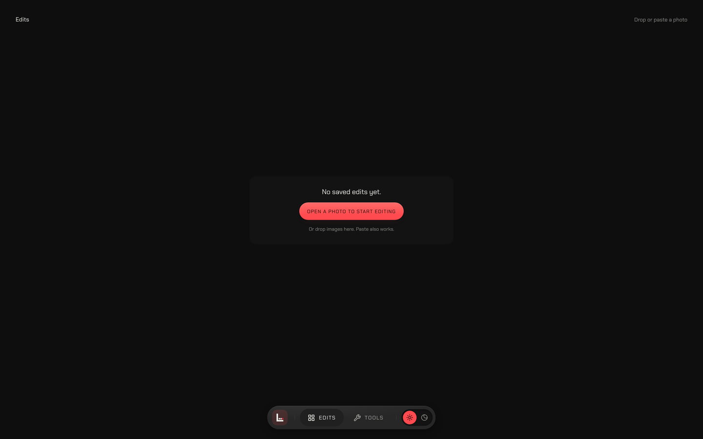
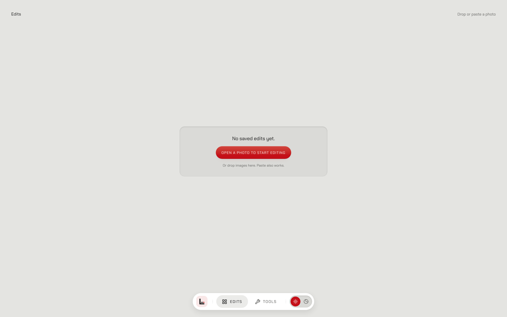
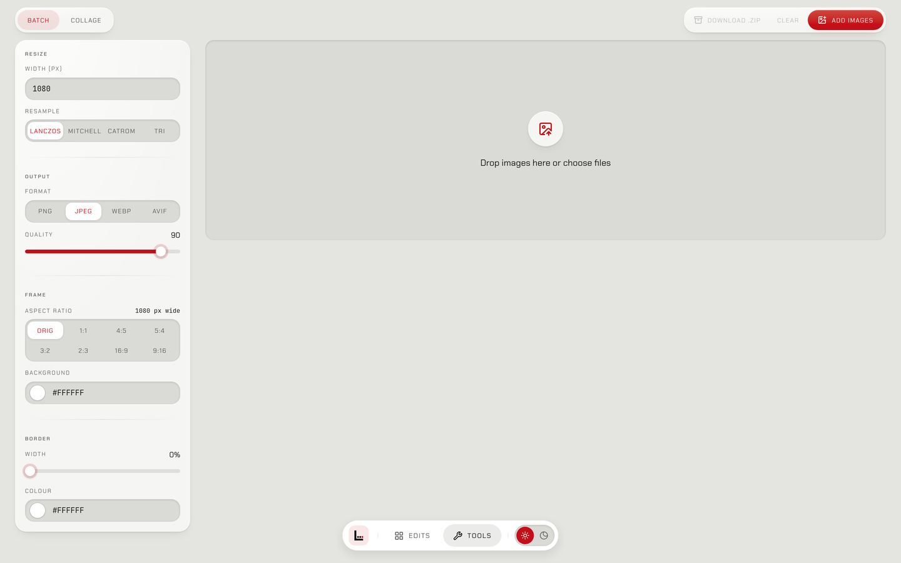
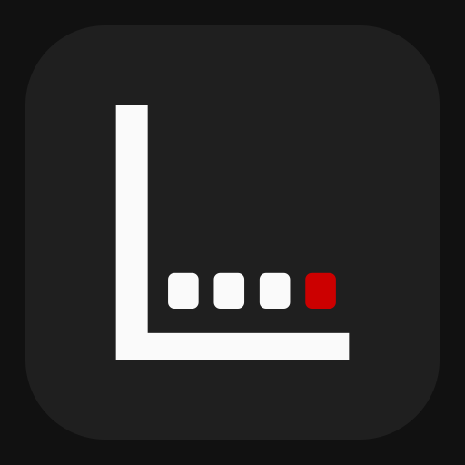

<p align="center">
  <picture>
    <source media="(prefers-color-scheme: dark)" srcset="docs/brand/wordmark-dark.svg">
    
  </picture>
</p>

<p align="center">Film simulation color grading, entirely in your browser.</p>

A color-grading app for film simulation. Web-first, client-side only — all image processing runs locally via WebGPU shaders. Your photos never leave your browser.

It's a monorepo with a few packages under `packages/`. Everything is built with Effect (v4 beta) and follows a TEA architecture via [foldkit](https://github.com/foldkit/foldkit).

## Screenshots

<table>
  <tr>
    <td align="center"><a href="docs/screenshots/gallery-dark.png"></a><br><sub>Gallery, dark</sub></td>
    <td align="center"><a href="docs/screenshots/gallery-light.png"></a><br><sub>Gallery, light</sub></td>
  </tr>
  <tr>
    <td align="center" colspan="2"><a href="docs/screenshots/tools.png"></a><br><sub>Tools</sub></td>
  </tr>
</table>

## Packages

- **`@lutra/engine`** — the pure computational core. Owns the layer registry, WGSL shader generation, chain source assembly, and colorspace conversions. No WebGPU pipeline, no DOM, no UI. Just math and shaders.

- **`@lutra/frontend`** — the web app. Handles WebGPU pipeline setup (device, bind groups, compute passes), the TEA-based UI, and all browser-side concerns. Consumes `@lutra/engine` as a library.

- **`@lutra/store`** — the persistence seam. Defines the Edit/Edit summary schemas, the Edit store service contract, and the browser IndexedDB implementation. A future server-side store swaps in behind the same interface.

- **RAW decoding** — [FlashRaw](https://flashraw.ybouane.com), a Rust decoder compiled to WebAssembly, installed from npm (`flashraw`).

## How it works

Adjustments are non-destructive, ordered, and intentionally limited in scope. You stack adjustment layers into an edit chain — LUT, exposure, contrast, grain, whatever — and the chain runs as a sequence of WebGPU compute passes. Each layer consumes the result of the previous one. Order matters.

The v1 palette is thirteen adjustment layer types: LUT, Exposure, Contrast, Shadows, Highlights, Tone Curve, White Balance, Saturation, Color Mixer, Grain, Vignette, Chromatic Aberration, and Clarity. That's it. Limitation is the feature — a small palette that pushes you toward a film look quickly and keeps you from runaway editing.

All processing happens in compute shaders. The chain assembler concatenates layer bodies into a single shader program, and the frontend executes it through WebGPU. Intermediate textures are `rgba16float` to avoid banding. The final pass encodes to sRGB and blits to the canvas. The processed frame never leaves the GPU on the display path — readback only happens on export.

## Getting started

```bash
# install dependencies
pnpm install

# start the dev server
pnpm dev

# run the full test suite
pnpm test

# typecheck everything
pnpm typecheck
```

The dev server runs at `http://localhost:5173` by default.

## Building

```bash
pnpm build
```

This runs `turbo build` across all packages. The frontend output goes to `packages/frontend/dist/`.

## Deployment

Deployed to Cloudflare via [Alchemy](https://alchemy.run). The site lives at `lutra.elianiva.com`.

```bash
pnpm infra:deploy
```

## Tech stack

- **Effect** (v4 beta) — used throughout for the public API, error handling, dependency injection, and Schema-based data modeling
- **foldkit** — TEA architecture for the frontend UI
- **WebGPU** — compute shaders for image processing, render pipeline for presentation
- **Tailwind CSS** — styling
- **Turbo** — monorepo task orchestration
- **jj** — version control (not Git)

## Development notes

- ADRs live in `docs/adr/` — that's the permanent record for architectural decisions
- The engine is pure TypeScript, no build step — the frontend consumes it via a Vite resolve alias
- Shader bodies are hand-ported from SkSL to WGSL (no transpilation layer)
- The LUT library is vendored — 296 film-emulation `.cube` files mirrored from G'MIC film color presets
- Tests are written alongside each workstream, not as a separate phase

## Brand



The wordmark is [Michroma](https://fonts.google.com/specimen/Michroma) (SIL Open Font License) capitals outlined to paths. The L carries four film perforations, and the A is an open Λ whose crossbar is replaced by a single red sprocket hole. The app icon and favicon use the mark as drawn; the navigation pill uses a heavier cut of the L that stays legible at 16 px. The editor's top bar shows the full wordmark.

The SVGs are in `docs/brand/`: the wordmark and mark, each in a dark, light, and single-color version. The app icons are in `packages/frontend/public/icons/`. After you change `icon.svg` or `icon-maskable.svg`, run `bun scripts/build-icons.ts` to regenerate the PNG icons and iOS splash screens.

## License

[MIT](LICENSE)
